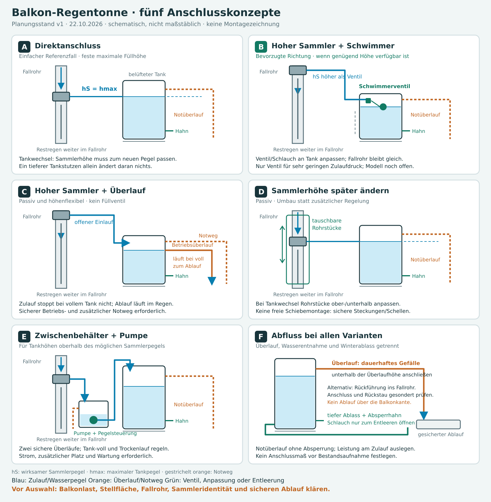
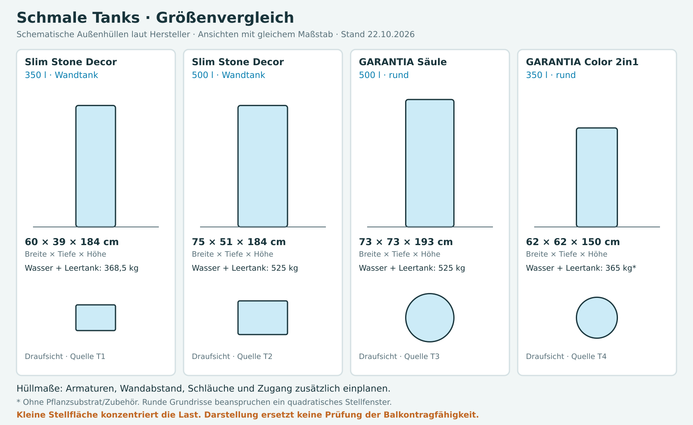

# Balkon-Regentonne · Konzept v1

Stand 22.10.2026. Empfehlung = Planungsableitung, keine freigegebene Ausführung. Bestandsmaße, Lastnachweis, sicherer Ablauf und genaue Sammlerausführung fehlen. Rechercheberichte: [Sammler/Hydraulik](scratchpad/research/E1.md), [Tankformen](scratchpad/research/E2.md).

**Aktueller Produkt-/Anschlussstand:** [Anschluss v2](anschluss_v2.md) dokumentiert die endgültig gewählten GARDENA-Tüllen für 25-mm-Schlauch und den gewählten STOUCLA-Hahn IG/IG. Die Grundkonzepte und Grafiken dieser Fassung bleiben als Variantenvergleich erhalten.

## Grafiken

**Ausgeführt:** SVGs mit `zeichnung_v1.py` erzeugt und als PNG gerendert. Konzepte schematisch, ohne Einbaumaße; Tankgrafik zeigt maßstäbliche Außenhüllen, keine nachgezeichneten Produktkonturen. Herstellerzeichnungen und Originalanforderung sind die Vergleichsbasis. Anlagen am Balkon wurden weder vermessen noch erprobt.

## Empfehlung

**Vermutet / Planungsableitung:** Für wechselnde Tankhöhen zuerst **B: Sammler oberhalb des höchsten vorgesehenen Tankzulaufs + mechanisches Schwimmerventil im jeweiligen Tank** prüfen. Schlauch und Ventilhalterung werden an den Tank angepasst; der Sammler kann bleiben. Voraussetzung: genügend Montagehöhe, belüfteter Tank, passendes Ventil für sehr geringen Druck sowie ein unabhängiger, sicher abgeführter Notüberlauf. Noch kein konkretes Ventil oder Adapter bestätigt.

**Vermutet / Alternative:** Ohne geeignete Ventilmontage ist **D: Sammler mit austauschbaren Rohrabschnitten versetzen** die einfache passive Lösung. Fehlt Höhe für Schwerkraft, bleibt **E: Zwischenbehälter mit Pumpe**. **C: hoher Sammler mit ständigem Betriebsüberlauf** ist ebenfalls passiv und höhenflexibel, setzt aber einen zuverlässig leistungsfähigen Ablauf voraus. **A: direkter Anschluss** passt erst, wenn der Maximalpegel feststeht.

## Vorhandener Sammler

**Gelesen:** SAREI bestätigt für die Baureihe einen Überlaufstopp mit Rückleitung überschüssigen Wassers ins Fallrohr [S1]. Das aktuelle Datenblatt zum Modell `znregs100`, EAN `4260036893847`, nennt Zink/Titanzink, DN 100, 120 × 100 × 170 mm und Steckverbindung [S2]. Das separat gelistete Anschlussset `re3861`, EAN `4260036893861`, ist mit 500 mm und 1 Zoll bezeichnet [S3]; genaue Gewinde-/Stutzengeometrie bleibt offen. Der Kauf dieses Sets wurde nicht angegeben.

**Vermutet:** Der gekaufte Amazon-Artikel ASIN `B00UFJLVHW` entspricht diesem DN-100-Sammler. Nur ein Drittmarktplatz verbindet ASIN und EAN; Amazon war nicht abrufbar. Vor einer Teilefestlegung EAN/Bezeichnung und Anschlüsse am Bestand vergleichen. Produktabmessungen sind keine Schnittmaße; eine vermasste SAREI-Montageanleitung liegt nicht vor.

## Hydraulik und Höhenbindung

**Vermutet / physikalische Planungsableitung:** Beim direkten, wassergefüllten Schlauchanschluss mit freiem Druckausgleich bestimmt der wirksame Wasserspiegel des Sammlers den erreichbaren Tankpegel. Bei richtigem Höhenausgleich läuft weiterer Regen im Fallrohr weiter. Sitzt der Sammler zu tief, bleibt der Tank teilweise leer; sitzt er zu hoch, kann der Tank vor dem sammlerbedingten Stopp überlaufen. Die genaue Bezugshöhe muss aus Montagevorgabe oder Funktionserprobung des vorhandenen Sammlers kommen.

- Längerer Schlauch: gleicht Abstand aus, erhöht die nutzbare Füllhöhe nicht; Reibung kann den Zulauf verringern.
- Tankstutzen weiter unten: verändert den Gleichgewichtspegel nicht; Leitung und Dichtung bleiben unter dem Wasserdruck des Tanks. Trennen ohne tankseitige Absperrung kann den Tank entleeren.
- Schlauch oben über den Rand hängen: braucht bei Schwerkraft einen ausreichend hohen Sammler und freie, entlüftbare Führung; hebt Wasser nicht von selbst über einen höheren Scheitel.
- Podest: verschiebt den Tank als Ganzes; löst die allgemeine Höhenflexibilität nicht und verändert Last/Kippsicherheit. Kein Podest eingeplant.

## Vergleich der fünf Konzepte

Alle Bewertungen **vermutet / Planungsableitung**, nicht am Bestand getestet. Aufwand relativ; keine Preis- oder Zeitangabe.

| Variante | Höhenkompatibilität | Vorteile | Nachteile / Störfall | Voraussetzung |
|---|---|---|---|---|
| A · Direktschlauch | Maximaler Tankpegel an wirksame Sammlerhöhe gebunden | Passiv, wenig Bauteile; Sammlerfunktion nutzbar | Tankwechsel erfordert passenden Pegel; Verstopfung/Rückstau bleibt zu behandeln | Gefüllte, freie Verbindung; definierte Montagehöhe; gesicherter Notweg |
| B · Hoher Sammler + Schwimmerventil | Verschiedene Tanks unterhalb des verfügbaren Sammlerpegels | Passiv; Füllstand am Tank einstellbar; kein Fallrohrumbau beim passenden Tankwechsel | Ventil kann klemmen/lecken; bei zu wenig Druck ungenügender Durchfluss; Zugang und Platz nötig | Zulaufhöhe über Ventileinlauf; geprüftes Niederdruckventil, sichere Halterung, Notüberlauf |
| C · Hoher Sammler + Betriebsüberlauf | Verschiedene Tanks unterhalb des verfügbaren Sammlerpegels | Passiv; kein Füllventil | Bei vollem Tank fließt sämtlicher weiterer abgezweigter Regen durch den Tanküberlauf; Verstopfung kritisch | Betriebsüberlauf für maximalen Zulauf plus unabhängiger sicherer Notweg; frostfrei betreiben |
| D · Sammler über Rohrsegmente versetzen | Nach Tankwechsel neu einstellbar, innerhalb des zugänglichen Rohrbereichs | Passiv; danach einfacher Direktbetrieb | Fallrohr muss bei Tankwechsel umgebaut werden; kein belegtes Schnellverstellsystem | Passende Rohrstücke, Muffen/Schellen, sichere Befestigung und zulässiger Eingriff |
| E · Zwischenbehälter + Pumpe | Tank kann höher als der Sammler stehen, innerhalb der Pumpenauslegung | Größte Freiheit der relativen Aufstellhöhen | Zusätzlicher Platz, Strom, Steuerung, Wartung; Ausfall- und Rückhebergefahr | Pegelsteuerung in beiden Behältern, Trockenlaufschutz, sichere Überläufe, geeignete Außeninstallation |

**Vermutet / verworfene Ergänzungen:** Manuelles Absperren ist als Wartungsfunktion sinnvoll, als alleiniger Füllstopp bei unbeaufsichtigtem Regen ungeeignet. Ein Rückschlagventil allein begrenzt keinen Tankfüllstand und verändert die Rückleitungsfunktion des Sammlers; dafür nicht einplanen. Eine externe Schwimmerkammer wäre eine bauliche Abwandlung von B mit zusätzlichen Dichtstellen, keine für diesen Balkon belegte Vereinfachung. Zwei verbundene Tanks könnten die Formwahl erweitern, brauchen zusätzliche Stellfläche; der niedrigste offene Überlauf begrenzt den gemeinsamen Pegel.

## B · Austauschbares Anschlussmodul

**Vermutet / Konzept:** Sammler → abnehmbare, ausreichend große Schlauchleitung → mechanisches Zulauf-Schwimmerventil → belüfteter Tank. Im Tank geschlossenes Ventil staut die Leitung bis zum Sammler; dessen innerer Bypass muss den Regen dann im Fallrohr weiterführen. Das Funktionsprinzip ist durch Herstellerangaben zu Sammler und Schwimmerventilen gestützt, diese konkrete Kombination ist nicht bestätigt [S1, V1, V2].

1. Sammler oberhalb des höchsten vorgesehenen Ventileinlaufs anordnen; sämtliche Schlauchscheitel ebenfalls unter dem verfügbaren Sammlerwasserspiegel halten. Vor Tankwahl noch nicht ins Fallrohr schneiden.
2. Ventil im zugänglichen Deckel-/Revisionsbereich des jeweiligen Tanks montieren. Halterung stabil und lösbar; Schwimmer darf nicht Wand, Deckel oder Pflanzschale berühren. Vorhandene Tankanschlüsse/zulässige Planflächen nutzen; keine universelle Bohrfreigabe annehmen.
3. Schlauchlänge, tankseitige Durchführung und Halterung je Tank tauschen; Absperrmöglichkeit für Wartung einplanen. Notüberlauf separat, ohne absperrbaren Kugelhahn.
4. Bei einem Höhenunterschied von 20/50/100 cm stehen rechnerisch nur etwa 0,020/0,049/0,098 bar statischer Druck zur Verfügung; Strömungsverluste vermindern den nutzbaren Druck. Ein für Leitungswasser gedachtes Ventil kann dafür ungeeignet sein. Auslegung nach Mindest-/Maximaldruck, Durchfluss und Schließverhalten [V2].
5. Zulauf bei leerem Tank, langsames und schnelles Schließen bei vollem Tank sowie Weiterleitung im Fallrohr mit kontrollierter Wassermenge testen. Unabhängigen Tanknotüberlauf auch bei blockiertem Ventil prüfen. Prüfen, ob die Anlage bei stehender Wassersäule dicht bleibt.

**Gelesen:** Beckmann beschreibt das Schwimmerventil als Füllstopp für Regenfässer bei höher liegendem Füllautomaten [V1]. Die dort genannte Höhenbegrenzung von 6 m betrifft Beckmanns System; keine Übertragung auf SAREI oder ein noch auszuwählendes Ventil. Mankenberg verlangt Ventilauswahl nach Differenzdruck/Durchfluss und weist auf mögliche Sitzleckage je Ventil hin [V2].

**Vermutet / Komponentenbedarf, keine Bestellliste:** geeignete Schlauchleitung; passende Sammler-/Tankadapter; mechanisches Regenwasser-Niederdruckventil; zugängliche Halterung; Wartungsabsperrung; getrennte Überlaufleitung; tiefer Ablass und Entnahmehahn; geprüfte Kippsicherung. Stückzahlen und Nennweiten erst nach Maßaufnahme.

## Überlauf, Nutzung und Entleerung

**Vermutet / Planungsanforderungen:** Drei Funktionen getrennt vorsehen: Zapfhahn zum Gießen; hoch liegender Überlauf; tiefer Ablass zur vollständigen Entleerung. Hahnanschlüsse sind nicht automatisch Überlaufanschlüsse.

- **Normalbetrieb:** A/D nutzen bei passender Höhe den Sammlerbypass; B schließt das Ventil. C benötigt einen kontinuierlichen Betriebsüberlauf; E stoppt die Pumpe bei vollem Tank, der Zwischenbehälter muss weiteren Regen sicher abführen.
- **Tanknotüberlauf:** oberhalb des normalen Füllpegels, unterhalb unkontrollierter Austrittsstellen; belüftet, reinigbar, ohne Absperrung. Mit durchgehendem Gefälle zu einem geeigneten Ablauf. Feinmaschige Insektensperren nur bei ausreichend freiem/reinigbarem Querschnitt. Bei C zusätzlich zum Betriebsweg einen unabhängigen Notweg planen.
- **Rückführung ins Fallrohr:** Anschluss unterhalb des Tanküberlaufs, so tief, dass durchgehend Gefälle möglich ist; freier Hauptabfluss muss erhalten bleiben. Geeignete Anschlussform, Rückstaurisiko und Wartungszugang vor Ort klären. Kein pauschaler Anschluss über T-Stück oder Rückschlagklappe festgelegt; ein Rückstauverschluss allein ersetzt keine gesicherte Entwässerungsplanung.
- **Balkonablauf:** nur nutzen, wenn er dafür tatsächlich geeignet und ausreichend leistungsfähig ist; keine Freigabe aus bloßem Vorhandensein ableiten. Kein gezielter Abfluss über Balkonkante, Fassade oder Nachbarbalkon.
- **Querschnitt:** nach größtem Sammlerzulauf und verfügbarer Höhendifferenz auslegen. Dachfläche, Regenanfall und Sammlerleistung unbekannt; weder DN 32 noch DN 50 pauschal bestätigt. Ein kurzer 1-Zoll-Zulauf garantiert keine ausreichende Ablaufleistung.
- **Winter:** Zulauf sicher außer Betrieb, Tank/Schläuche/Ventil entleeren, Hahn gemäß Tankanleitung öffnen/ausbauen. Vollständige Winterentleerung für oberirdische GARANTIA-Speicher ist Herstelleranforderung [W1].
- **Pumpe E:** Zwischenbehälter unter dem Sammler, eigener kontrollierter Abfluss für Stromausfall und Haupttank voll. Pumpendruckleitung mit freiem Auslauf/Luftunterbrechung oberhalb des maximalen Haupttankpegels planen, damit kein unkontrollierter Siphoneffekt entsteht. Pumpenauslegung, Außenstromversorgung und Fehlerszenarien separat bearbeiten.

## Tankformen · noch keine Kaufentscheidung

**Gelesen:** Vier Herstellerbeispiele im Wunschbereich; Außenmaße, keine nutzbare Restfläche am Balkon. **Ausgeführt:** geometrische Hüllflächen und Wasser-plus-Leergewicht rechnerisch bestimmt. Rundtanks benötigen als rechteckiges Stellfenster mindestens Ø × Ø; ihre Kreisfläche ist keine rechteckig nutzbare Stellfläche. Keine der Flächen ist eine nachgewiesene Kontakt-/Lastverteilfläche.

| Quelle / Beispiel | Volumen | B × T × H | Hüllfläche / Stellfenster | Wasser + Leertank | Einordnung |
|---|---:|---|---|---:|---|
| T1 · 4rain Slim Stone Decor 350, Art. 211860/211861 | 350 l | 60 × 39 × 184 cm | 0,234 m² Rechteck | ca. 368,5 kg | Geringste Tiefe dieser Beispiele; Wandbefestigung laut Anleitung erforderlich |
| T2 · 4rain Slim Stone Decor 500, Art. 211820/211821 | 500 l | 75 × 51 × 184 cm | 0,3825 m² Rechteck | ca. 525 kg | 150 l mehr, benötigt 15 cm mehr Breite und 12 cm mehr Tiefe als T1 |
| T3 · GARANTIA Säulentank 500, Art. 326510/326512 | 500 l | Ø 73 × 193 cm | Kreis ca. 0,419 m²; Stellfenster 0,5329 m² | ca. 525 kg | Schmale Säulenwirkung; mehr Tiefe als Wandtanks |
| T4 · GARANTIA Color 2in1 350, Art. 326100 | 350 l | Ø 62 × 150 cm | Kreis ca. 0,302 m²; Stellfenster 0,3844 m² | ca. 365 kg | Niedriger; Pflanzschale benötigt Innenraum/Zugang und erhöht bei Bepflanzung die Masse |

Herstellerdaten gelesen 22.10.2026; Originalzeichnungen T1–T3 nennen Maßtoleranzen ±3 %. Stellreserve vorsehen. Alle Gewichte ohne Armaturen, Befestigung, Restablagerungen und ggf. Pflanzsubstrat. Anschlüsse, Deckel und konkrete Überlaufnachrüstung im [Detailvergleich](scratchpad/research/E2.md). Preise, Lieferbarkeit und günstigster Anbieter nicht recherchiert; keine vom Budget abhängige Tankentscheidung getroffen.

**Vermutet / Auswahlrichtung:** Für geringen Balkonplatz zuerst einen rechteckigen Wandtank betrachten. T1 ist das tiefensparendste Beispiel; T2 nur weiterverfolgen, wenn größere Stellfläche und höhere Last möglich sind. Budget, Optik und Montagezugang fehlen für eine Kaufempfehlung. Andere Hersteller nicht ausgeschlossen; Arves war laut Recherchepreflight gesperrt.

## Vor Festlegung offen

- **Tragfähigkeit:** 300–500 l entsprechen ungefähr 300–500 kg Wasser, zuzüglich Speicher und Zubehör. Zulässige konzentrierte Last und tatsächliche Bodenauflage fachlich am Balkon prüfen; allgemeine kg/m²-Werte und eine beliebige Unterlegplatte ergeben keine Freigabe. Bei Tankwahl nicht nur Maximalvolumen, sondern auch maximal zulässigen Betriebsfüllstand festlegen.
- **Stand/Kippsicherung:** Aufstelluntergrund, Gefälle/Abdichtung, tankkonforme Auflage, leeren Tank bei Wind und vorgesehene Befestigung an geeigneter Wand prüfen. Keine Befestigung nur am Geländer oder in Wärmedämmung ableiten.
- **Maße:** nutzbare Breite/Tiefe/Höhe, Türen/Laufwege, Revisionszugang; Wandabstand, Armaturenüberstand und Schlauchführung zusätzlich zum Tankmaß. Abstand und Höhenlage Fallrohr ↔ Tank ↔ Ablauf messen.
- **Fallrohr:** Material, Nennweite/Geometrie, erreichbare Rohrabschnitte und Befestigungen; zulässiger Eingriff/Eigentümerzustimmung klären. Schwerkraftentwässerung vorausgesetzt; besondere Dachentwässerung nicht beurteilt.
- **Bestand:** Sammler-EAN/Bezeichnung, Stutzengeometrie, Montagebezugshöhe; vorhandenes Schlauchset feststellen.
- **Wasser:** Dachmaterial und Verschmutzung, Reinigung/Laub, Wartungszugang; nur als Betriebswasser zum Gießen geplant. Keine Verbindung mit Trinkwasser vorgesehen.
- **Ablauf:** gesicherter Zielpunkt, Rückstau, Leistung und Notweg. Ohne geklärten Ablauf keine Ausführungsplanung abschließen.
- **Bedienung:** gewünschte Zapfhöhe, Gießkanne/Schlauch, Frostbetrieb und Zugang für Ventil-/Tankreinigung.

## Quellen · Direktabrufe

Prüfvermerk je Quelle: **gelesen**, abgerufene Herstellerangabe vom 22.10.2026. Eigene Wiederabrufe/Ergebnisse im Prüfprotokoll; ein Bericht eines Rechercheagenten ist für den Hauptagenten gelesen, nicht selbst ausgeführt. Quellenwerte sind keine Messung des vorhandenen Produkts. Amazon nicht abrufbar; ASIN-Zuordnung bleibt vermutet.

| Kürzel | Direktquelle | Verwendung |
|---|---|---|
| S1 | [SAREI Produktseite](https://www.sarei.de/produkte/regenwassersammler-schlauchanschluss/), [Baureihendatenblatt](https://www.sarei.de/wp-content/uploads/2025/02/Produktdatenblatt_Regenwassersammler_Schlauchanschlussset.pdf) | Überlaufstopp, Baureihe, Zubehör; Datenblattstand Juni 2017 |
| S2 | [SAREI Sammlerdatenblatt EAN 4260036893847](https://portal.sarei.de/datenblatt/4260036893847.pdf) | DN100, Produktabmessungen; Rechercheagent konnte abrufen, Wiederabruf im Webparser scheiterte |
| S3 | [SAREI Anschlussset EAN 4260036893861](https://portal.sarei.de/datenblatt/4260036893861.pdf) | Set 500 mm/1 Zoll; Gewinde offen; Wiederabruf im Webparser scheiterte |
| V1 | [Beckmann-Katalog, S.124](https://www.beckmann-kg.de/websale8_shop-beckmann/benutzer/templates/ws-customer_01-aa/%24ws-customer-data-01-aa/katalog_gesamt.pdf) | Schwimmerventilprinzip; kein SAREI-Kompatibilitätsbeleg |
| V2 | [Mankenberg Know-how Schwimmerventile](https://www.mankenberg.com/de/schwimmerventile/know-how) | Ventilauswahl nach Druck/Durchfluss; mögliche Leckage |
| T1 | [Herstellerseite Slim Stone Decor 350/500](https://www.garantia.com/en/rainwater-tanks-overground/slimline-rainwater-tanks/wall-mounted-slim-stone-decor.html), [Maßskizze 350](https://www.garantia.com/fileadmin/Files_All_General/Documents/Dimension_drawing/Massskizze_Slim_Stone_Decor_350l.pdf), [Aufstellung](https://www.garantia.com/fileadmin/Files_All_General/Documents/Instructions/4rain_EBA_Slim_SlimDecor_StoneWood.pdf) | T1-Außenmaße, Gewicht, Wandbefestigung |
| T2 | [Maßskizze Slim Stone Decor 500](https://www.garantia.com/fileadmin/media/4rain_Massskizze_Slim_Stone_Decor_500l.pdf), [Aufstellung](https://www.garantia.com/fileadmin/Files_All_General/Documents/Instructions/EBA_Basic_Classic_Slim_SlimDecor_Quadro.pdf) | T2-Außenmaße/Gewicht, Aufstellung |
| T3 | [Maßskizze Säulentank 500](https://www.garantia.com/fileadmin/Files_All_General/Documents/Dimension_drawing/MSZ-GARANTIA-Saulentank-500L.pdf), [Produktseite](https://www.garantia.com/en/rainwater-tanks-overground/mediterranean-style-rainwater-tanks/column-tank/column-tank-stone-grey.html) | T3-Außenmaße/Gewicht |
| T4 | [Color 2in1 350 apple](https://www.garantia.com/en/rainwater-tanks-overground/rainwater-tanks-with-planters/color-2in1-water-tank/color-2in1-water-tank-apple.html), [Aufstellung 2in1](https://www.garantia.com/fileadmin/Files_All_General/Documents/Instructions/Color_Stone_Natura_Linus_2in1_Aufstellanleitung.pdf) | T4-Außenmaße/Gewicht/Pflanzschale; eigener Webparser-Wiederabruf mit Timeout |
| W1 | [GARANTIA FAQ](https://www.garantia.com/de/service/faqs.html) | Vollständige Winterentleerung oberirdischer Behälter |
